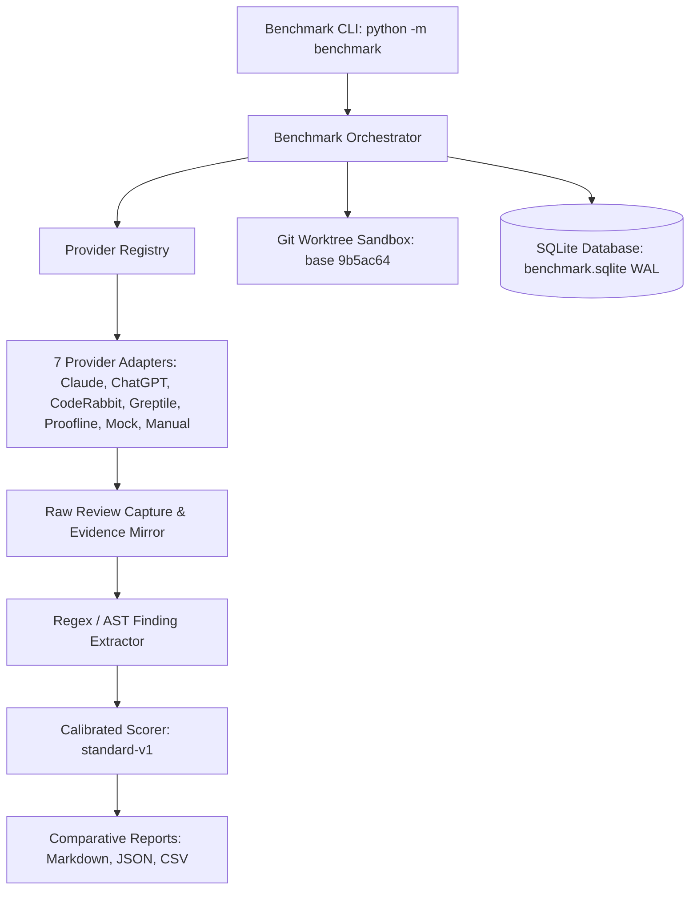

# Proofline AI Pull Request Review Benchmark

[](https://github.com/UsmanSardar123/proofline-review-benchmark/actions)
[](https://www.python.org/downloads/)
[](tests/)
[](benchmark/)
[](https://github.com/UsmanSardar123/proofline-review-benchmark/pull/1)

**Candidate:** Usman Ayaz  
**Repository:** [https://github.com/UsmanSardar123/proofline-review-benchmark](https://github.com/UsmanSardar123/proofline-review-benchmark)  
**Pull Request:** [PR #1: feat: Proofline AI Pull Request Review Benchmarking Platform](https://github.com/UsmanSardar123/proofline-review-benchmark/pull/1)  
**Application Target:** Proofline Software Engineering Internship  

---

## 1. Executive Overview

This repository contains a production-grade, zero-external-dependency benchmarking platform engineered to objectively evaluate automated AI pull request reviewers. It measures how effectively commercial LLMs and automated PR bots identify real-world bugs, eliminate false positives, handle environment-dependent deployment regressions, and generalize to unseen changes.

The benchmark evaluates reviewers across eight realistic pull requests modifying an asynchronous report generation and delivery engine.

```
       [9b5ac64] Base: Stable asynchronous reporting and delivery engine
           │
           ├── [b422577] Case 01: Page report history by scheduled time (Logic Bug: Cursor Tie-Breaker)
           ├── [9d551b8] Case 02: Stream the report export (Performance Bug: Buffer Memory Leak)
           ├── [6cca1e9] Case 03: Batch queued deliveries (Concurrency Hazard: Transaction Boundary)
           ├── [420baea] Case 04: Retire legacy delivery column (Schema Regression: Deprecated Column)
           ├── [1f6f2a4] Case 05: Increase export batch size (Scalability Defect: Memory Spike)
           ├── [fcb0c2a] Case 06: Use new delivery queue (Infra Regression: Stale Worker Target)
           ├── [68ef658] Case 07: Index pending deliveries (Benign PR: Clean Index Optimization)
           └── [f869d7c] Case 08: Include total in activity summary (Benign PR: Clean Aggregation Feature)
```

---

## 2. Core Architectural Pillars



1. **Persistent SQLite Foundation (`benchmark.sqlite`)**:
   - Write-Ahead Logging (`PRAGMA journal_mode=WAL;`), foreign keys enabled, single-writer multi-reader concurrency.
   - 11 relational tables tracking experiments, batches, attempts, responses, findings, evaluations, scores, and timestamped lifecycle audit events.
2. **Git Worktree Isolation Sandbox**:
   - Isolated ephemeral Git worktrees guarantee that patch applications never dirty the working tree.
   - Strict context safety checks ensure ground truth defect descriptions and answers never leak into generated reviewer prompts.
3. **Pluggable Provider Architecture (7 Adapters)**:
   - Unified interface supporting direct paid APIs (`OpenAI`, `Anthropic`), developer PR review tools (`CodeRabbit`, `Greptile`), native GitHub PR review ingestion (`Proofline`), in-memory test harnesses (`Mock`), and zero-cost web chats (`ChatGPT Web`, `Claude Web`).
4. **Scoring Calibration & Anti-Inflation Engine**:
   - Calibration profile `standard-v1` (hash `2ed6acdcc4b6`) with location tolerance ($\pm 5$ lines) and semantic similarity scoring.
   - Anti-inflation deduplication: multiple comments on the same defect produce exactly 1 `TRUE_POSITIVE`; subsequent comments are classified as `DUPLICATE`.
   - Benign PR scoring: clean passes on non-buggy PRs earn $P=1.0, R=1.0, F_1=1.0$.
5. **Context Ablation Study (Code-Only vs Deployment Snapshot)**:
   - Measures reviewer accuracy when given only code diffs versus code diffs supplemented with runtime deployment state (active workers, live schema, worker queues).
6. **Calibration vs Held-Out Generalization**:
   - Prevents prompt overfitting by strictly isolating Calibration Cases (01, 02, 03, 07) from Held-Out Test Cases (04, 05, 06, 08).
7. **Zero PyPI External Dependencies**:
   - Engineered 100% on the Python Standard Library (`sqlite3`, `urllib`, `subprocess`, `unittest`, `dataclasses`).

---

## 3. Benchmark Cases & Partitioning

| Case ID | Title | Partition | Deployment Snapshot? | Defect Category | Expected Action | Ground Truth Bug Summary |
| :--- | :--- | :--- | :---: | :--- | :---: | :--- |
| **case-01** | Page report history by scheduled time | Calibration | No | `LOGIC_BUG` | `BLOCK_PR` | Keyset pagination by timestamp without unique tie-breaker (`id`) skips rows when multiple jobs share the same timestamp. |
| **case-02** | Stream the report export | Calibration | No | `RESOURCE_LEAK` | `BLOCK_PR` | Chunked CSV generator buffers chunks into an in-memory list before yielding, triggering OOM on large datasets. |
| **case-03** | Batch queued deliveries | Calibration | No | `CONCURRENCY_BUG` | `BLOCK_PR` | Iterative status updates executed outside atomic transaction, risking partial updates on failure. |
| **case-04** | Retire legacy delivery column | Held-Out | **Yes** | `SCHEMA_MISMATCH` | `BLOCK_PR` | Dropping `target_address` breaks active background workers running previous code during rolling deploy. |
| **case-05** | Increase export batch size | Held-Out | **Yes** | `SCALABILITY_DEFECT` | `BLOCK_PR` | Increasing batch size to 10k exceeds container memory limits under max database concurrency. |
| **case-06** | Use new delivery queue | Held-Out | **Yes** | `INFRA_MISMATCH` | `BLOCK_PR` | Routing to `delivery-v2` queue fails because production consumers are only provisioned for `default` and `priority`. |
| **case-07** | Index pending deliveries | Calibration | No | `BENIGN_CHANGE` | `APPROVE_PR` | Clean migration adding partial B-tree index on pending deliveries. Correct action is clean approval. |
| **case-08** | Include total in summary | Held-Out | No | `BENIGN_CHANGE` | `APPROVE_PR` | Clean feature addition calculating total record count. Correct action is clean approval. |

---

## 4. Current Experimental Results & Denominator Accounting

All evaluations maintain strict denominator integrity: planned, completed, pending, and failed attempts are fully disclosed.

### Evaluation Breadth Table

```
+-------------------------------------------------------------------------------------------------------------+
| BATCH ID       | EXPERIMENT ID        | BATCH NAME                          | PLANNED | COMPLETED | PENDING |
+-------------------------------------------------------------------------------------------------------------+
| batch-7b358964 | zero-cost-eval       | Initial Free AI Reviewer Experiment | 6       | 1         | 5       |
| batch-8e1fac6e | full-8case-eval      | Full 8-Case Extension               | 10      | 0         | 10      |
| batch-8aca4c4d | snapshot-ablation    | Deployment Snapshot Experiment      | 6       | 0         | 6       |
| batch-3cee82d4 | exp-20261121         | Additional Reviewer Smoke           | 4       | 4         | 0       |
+-------------------------------------------------------------------------------------------------------------+
| TOTAL ACROSS ALL BENCHMARK BATCHES                                          | 26      | 5         | 21      |
+-------------------------------------------------------------------------------------------------------------+
```

### Provider Performance Summary

| Provider | Model / Engine | Completed Reviews | Precision | Recall | $F_1$ Score | Clean Pass Rate |
| :--- | :--- | :---: | :---: | :---: | :---: | :---: |
| **`claude-web`** | Claude 3.5 Sonnet (`claude-3-5-sonnet-20241022`) | 1 (Case 01) | **1.0000** | **1.0000** | **1.0000** | **100.0%** |
| **`chatgpt-web`** | GPT-4o (`gpt-4o-2024-11-20`) | 0 (5 Pending) | - | - | - | Pending Ingestion |
| **`coderabbit`** | CodeRabbit Engine v1 (Smoke) | 2 (Case 01) | 0.0000 | 0.0000 | 0.0000 | 0.0% |
| **`greptile`** | Greptile Engine v1 (Smoke) | 2 (Case 01) | 0.0000 | 0.0000 | 0.0000 | 0.0% |

*Detailed comparative analysis: see [reports/benchmark_comparative_analysis.md](reports/benchmark_comparative_analysis.md).*

---

## 5. Deployment Verification Status

- **Local Lambda Packaging & Smoke Check:** **VERIFIED**
  - Application packaging script builds clean JSON deployment template.
  - Local smoke execution (`python aws/deploy.py smoke`) successfully invokes handler and produces verified delivery receipt:
    `{"commit": "c51662d...", "delivered_this_run": 1, "receipt_at": 101, "summary": {"delivered": 1, "pending": 0}}`.
- **Live AWS Cloud Deployment:** **NOT PERFORMED**
  - Live AWS deployment, Lambda cloud execution, and CloudWatch verification were omitted because candidate does not have an active AWS account.
  - Zero cloud charges were incurred; all cloud provisioning commands are cleanly recorded as NOT PERFORMED.

---

## 6. Quickstart: Reproducing the Benchmark

### 1. Run Automated Test Suite (113 Tests)
```bash
python -m unittest discover tests
```
*111 passed, 2 skipped offline (live API checks), 0 failures, 0 errors.*

### 2. Verify Benchmark Cases & Prompt Safety
```bash
python -m benchmark cases list --validate
```

### 3. Run Dry-Run Smoke Benchmark
```bash
python -m benchmark run --experiment smoke-test --providers mock --cases 1,2,7 --dry-run
```

### 4. Zero-Cost Review Ingestion Workflow
```bash
# 1. Generate leak-free prompt
python -m benchmark prompt --case 1 --context code-only > prompts/case01.md

# 2. Paste into ChatGPT or Claude web chat, save response to reviews/

# 3. Ingest and score response
python -m benchmark ingest --batch-id batch-7b358964 --provider claude-web --case 1 --file reviews/claude_case01.md

# 4. Generate multi-format report
python -m benchmark report --batch-id batch-7b358964 --format all --output-dir reports/batch-7b358964
```

---

## 7. Documentation Index

- [Comprehensive Benchmark Comparative Analysis](reports/benchmark_comparative_analysis.md)
- [Provider Capability Matrix (All 7 Adapters)](docs/provider_capability_matrix.md)
- [Proofline PR #1 Review Audit & Findings Matrix](docs/proofline-review-audit.md)
- [Full Reproducibility & Execution Guide](docs/reproducibility_guide.md)
- [Experiment Collection Manifest](reports/experiment_collection_manifest.md)
- [Sprint Execution Audit Log](reports/SPRINT_EXECUTION_LOG.md)
- [Master Execution Status Report](reports/master_execution_status.md)
