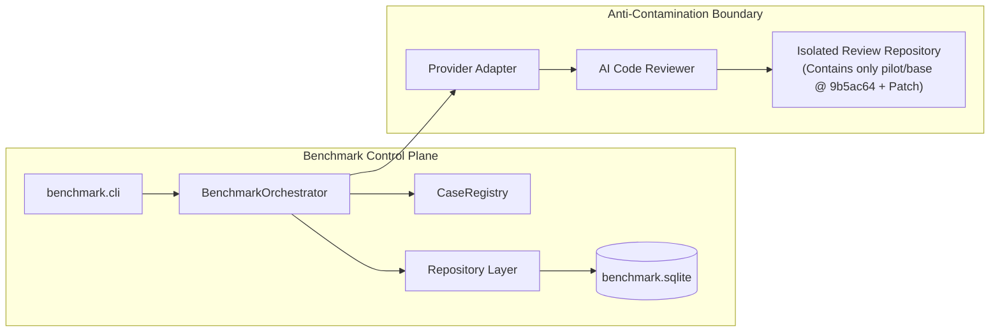
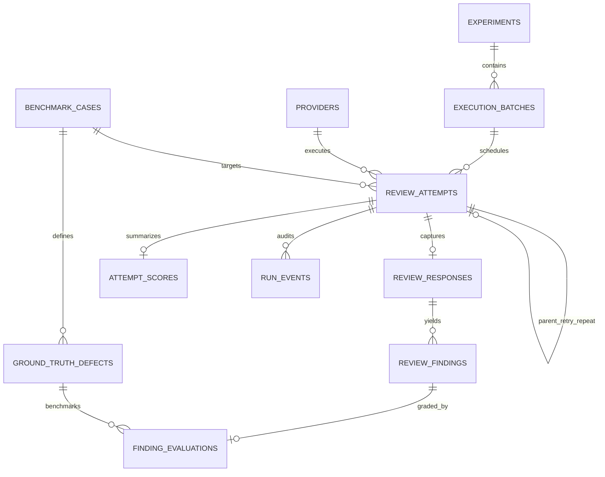
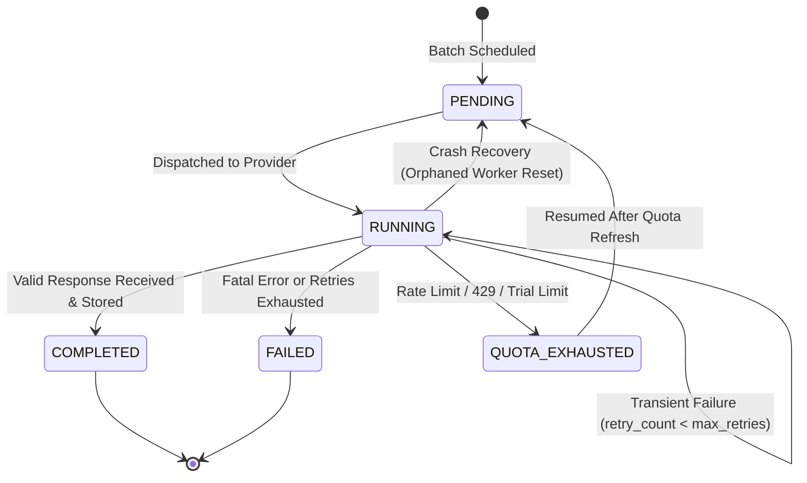

# Benchmark Foundation & Architecture Guide

Phase 1 establishes the architecture, database layer, domain contracts, and run lifecycle orchestrator for the Proofline AI Review Benchmark platform.

---

## 1. Architectural Overview

The benchmark engine is designed as an independent control plane housed in the `benchmark/` package. It evaluates genuine AI pull-request review providers against eight standardized benchmark cases derived from the scheduled-report starter application.



### Key Architectural Safeguards
1.  **Anti-Contamination ("No-Leak Rule"):** Reviewers are provided clean branches or repositories containing only application files (`reports.py`, `console.py`, `migrations/001_initial.sql`). Reviewers never receive benchmark engine code, case catalogs, or answer keys.
2.  **Zero Blast Radius to Starter App:** The starter application's database (`reports.sqlite`), migration runner (`reports.migrate`), and AWS packaging logic (`aws/deploy.py`) remain completely untouched.
3.  **CloudFormation Packaging Isolation:** Benchmark database migrations reside in `benchmark/migrations/` rather than the root `migrations/` directory. This ensures that `aws/deploy.py package` will never bundle benchmark code into the Lambda template or exceed CloudFormation's 51,200-byte ceiling.

---

## 2. Package & Folder Structure

```text
proofline-review-benchmark/
├── .github/workflows/          # Starter CI workflows (check.yml, aws.yml)
├── aws/                        # Starter AWS Lambda packaging & CloudFormation stack
├── cases/                      # Benchmark cases (01..08) with titles, bodies, patches, & evidence
├── docs/                       # Architecture and benchmark documentation
├── migrations/                 # Starter application migrations (001_initial.sql)
├── console.py                  # Starter operations console CLI
├── reports.py                  # Starter scheduled report service
│
├── benchmark/                  # Benchmark platform package
│   ├── cases/                  # Case discovery and catalog loading (CaseRegistry)
│   ├── config.py               # Paths, baseline commit (9b5ac64), and environment settings
│   ├── db/                     # SQLite connection factory and repository layer
│   │   ├── connection.py       # Connection management (WAL mode, foreign keys, timeouts)
│   │   ├── migrations.py       # Migration runner for benchmark.sqlite
│   │   └── repositories.py     # Typed repositories (Experiment, Batch, Provider, Case, Attempt, Response, Event)
│   ├── domain/                 # Pure domain models, enums, and data contracts
│   │   ├── enums.py            # AttemptStatus, ContextCondition, AttemptType, EvaluationClass
│   │   └── models.py           # Dataclasses with auto SHA-256 idempotency key generation
│   ├── migrations/             # Benchmark SQL migrations (001_initial_benchmark.sql)
│   ├── orchestrator/           # Batch scheduling, state machine transitions, crash recovery
│   │   └── engine.py           # BenchmarkOrchestrator
│   └── providers/              # Multi-provider adapter framework (BaseProviderAdapter, MockProviderAdapter)
│
└── tests/                      # Automated test suite (Python unittest)
    ├── test_database.py        # Database creation, migration, and foreign-key integrity
    ├── test_repositories.py    # Entity persistence across all 7 repositories
    ├── test_lifecycle.py       # Full attempt lifecycle, retries, repeats, and crash recovery
    └── test_starter_compat.py  # Backward-compatibility checks for console.py and aws/deploy.py
```

---

## 3. Database Schema Design (`benchmark.sqlite`)

The benchmark database operates in SQLite Write-Ahead Logging (`WAL`) mode with foreign key checks strictly enforced (`PRAGMA foreign_keys = ON;`).



### Table Definitions
*   **`experiments`**: Defines top-level campaigns, protocol versions, and descriptions.
*   **`execution_batches`**: Tracks planned denominators, start/completion times, and run status.
*   **`providers`**: Stores AI review engines, adapter types, and default models.
*   **`benchmark_cases`**: Stores case numbers (1–8), commit SHAs, patch paths, and deployment snapshots.
*   **`ground_truth_defects`**: Authoritative defect catalog and expected actions per case.
*   **`review_attempts`**: The atomic unit of observation. Enforces uniqueness on `(batch_id, provider_id, case_id, context_condition, attempt_number)` and stores unique SHA-256 idempotency keys.
*   **`review_responses`**: Stores pristine, unedited raw review output with token usage and duration.
*   **`review_findings`**: Parsed atomic findings and line references extracted from review responses.
*   **`finding_evaluations`**: Evaluation classifications (True Positive, False Positive, Missed, Valid Unexpected).
*   **`attempt_scores`**: Rollup precision, recall, and F1 metrics per attempt.
*   **`run_events`**: Append-only structured event log tracking state transitions and errors.

---

## 4. Run Lifecycle & State Machine



### Deduplication & Retries
1.  **Duplicate Protection:** `idempotency_key = sha256(batch_id + provider_id + case_id + context_condition + attempt_number)`. Prevents duplicate webhook deliveries from creating duplicate attempts.
2.  **Automatic Retries:** Handled within the existing attempt record; increments `retry_count` and updates `attempt_type = 'AUTOMATIC_RETRY'`. The planned denominator is preserved.
3.  **Intentional Repeats:** Creates a distinct attempt with `attempt_number = original.attempt_number + 1`, `attempt_type = 'INTENTIONAL_REPEAT'`, and `parent_attempt_id` referencing the origin.
4.  **Crash Recovery:** Orphaned attempts left in `RUNNING` without a persisted response are safely reset to `PENDING` upon running `recover_and_resume_batch`.

---

## 5. Local Setup & Testing Commands

### Prerequisites
*   Python 3.10+ (tested on Python 3.14 on Windows and Python 3.12 on Linux).
*   SQLite 3.35+.

### Running Migrations
To initialize or migrate the benchmark database programmatically:
```python
from benchmark.db.connection import get_connection
from benchmark.db.migrations import migrate_benchmark_db

db = get_connection("benchmark.sqlite")
migrate_benchmark_db(db)
```

### Executing the Test Suite
Run all automated unit and integration tests:
```powershell
py -m unittest discover -s tests -p "test_*.py" -v
```

### Verifying Starter Application Smoke Check
To verify that starter application packaging and Lambda simulation remain unaffected:
```powershell
py aws/deploy.py package --output temp-stack.json
py aws/deploy.py smoke --template temp-stack.json
```
