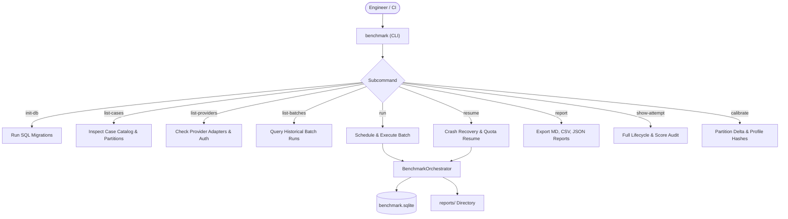

# Benchmark CLI, Reporting Workflows & Execution Automation

This guide documents the Proofline AI Review Benchmark command-line interface (`benchmark`), automated execution pipelines, failure recovery procedures, and structured reporting artifacts.

---

## 1. Overview & Architecture

The benchmark CLI is the primary operational interface for running evaluation batches, inspecting reviewer outputs, recovering from interruptions, and generating auditable reports.



### Core Design Invariants
1. **Clean Starter Isolation:** Benchmark automation code lives entirely in `benchmark/` and never touches starter files (`console.py`, `reports.py`, `migrations/`, `aws/`).
2. **Reviewer Anti-Contamination:** AI reviewers only inspect code diffs and deployment context snapshots. Case answer keys, ground truth defects, and held-out evaluations are never accessible to review prompts.
3. **Resumable & Idempotent:** Interrupted batches can be resumed without re-executing completed attempts. Crashed `RUNNING` attempts are safely reset to `PENDING`.
4. **Deterministic Auditing:** Every attempt records raw review responses, token usage, latency, extracted findings, ground truth evaluations, and chronological state transition events.

---

## 2. CLI Command Reference

The CLI can be invoked as a Python module or executable:
```sh
python -m benchmark <command> [options]
```

### 2.1 `init-db`
Initializes `benchmark.sqlite` and applies all pending SQL schema migrations idempotently.

```sh
python -m benchmark init-db [--db PATH]
```
- `--db PATH`: Path to benchmark SQLite database (default: `benchmark.sqlite`).

### 2.2 `list-cases`
Lists the eight benchmark cases, including titles, baseline commits, target commits, deployment snapshots, and partition allocations.

```sh
python -m benchmark list-cases [--partition {all,calibration,heldout}] [--db PATH]
```
- `--partition`: Filter cases by partition (`all`, `calibration`, `heldout`). Defaults to `all`.

**Example Output:**
```text
===============================================================================================
Case ID    #   Partition     Snapshot   Base -> Head       Title
-----------------------------------------------------------------------------------------------
case-01    1   Calibration   No         9b5ac64..b422577   Page report history by scheduled time
case-02    2   Calibration   No         9b5ac64..9d551b8   Stream the report export
case-03    3   Calibration   No         9b5ac64..6cca1e9   Batch queued deliveries
case-04    4   Held-Out      Yes        9b5ac64..420baea   Retire the legacy delivery column
case-05    5   Held-Out      Yes        9b5ac64..1f6f2a4   Increase export batch size
case-06    6   Held-Out      Yes        9b5ac64..fcb0c2a   Use the new delivery queue
case-07    7   Calibration   No         9b5ac64..68ef658   Index pending deliveries
case-08    8   Held-Out      No         9b5ac64..f869d7c   Include a total in the activity summary
===============================================================================================
```

### 2.3 `list-providers`
Lists registered AI code-reviewer provider adapters, default models, and environment credential statuses.

```sh
python -m benchmark list-providers
```

**Registered Providers:**
- `anthropic`: Anthropic Claude (`claude-3-5-sonnet-20241022`, requires `ANTHROPIC_API_KEY`)
- `openai`: OpenAI GPT-4o (`gpt-4o`, requires `OPENAI_API_KEY`)
- `coderabbit`: CodeRabbit AI (`coderabbit-review`, requires `CODERABBIT_API_KEY`)
- `mock`: Local Deterministic Mock Reviewer (`mock-model-v1`, zero cost)

### 2.4 `list-batches`
Lists historical benchmark execution batches, planned denominators, attempt statuses, and completion timestamps.

```sh
python -m benchmark list-batches [--limit N] [--db PATH]
```
- `--limit N`: Maximum recent batches to display (default: 20).

### 2.5 `run`
Schedules and executes a benchmark batch across designated providers, cases, and context conditions.

```sh
python -m benchmark run [options]
```

**Options:**
- `--experiment-id ID`: Top-level campaign identifier (default: `exp-YYYYMMDD`).
- `--batch-name NAME`: Human-readable label for the batch.
- `--providers LIST`: Comma-separated provider IDs (e.g. `mock,anthropic,openai,coderabbit`) or `all`.
- `--cases SELECTION`: `all` (1–8), `calibration` (1,2,3,7), `heldout` (4,5,6,8), or comma-separated numbers (e.g. `1,2,3`).
- `--context {both,code-only,code-and-snapshot}`: Context condition (default: `both`).
- `--repeats N`: Number of intentional repeats per provider-case pair (default: 1).
- `--dry-run`: Execute using deterministic offline fixtures without billable API charges.
- `--calibration-profile PROFILE`: Matching profile (`standard-v1`, `strict-v1`, `lenient-v1`).
- `--output-dir DIR`: Directory to write generated Markdown, CSV, and JSON reports.
- `--title TITLE`: Custom report heading.
- `--db PATH`: Database override.

**Example Invocations:**
```sh
# Dry-run test across all 8 cases and all 4 providers:
python -m benchmark run --providers all --cases all --context both --dry-run --output-dir reports/

# Calibration-only run:
python -m benchmark run --providers anthropic,openai --cases calibration --calibration-profile standard-v1

# Held-out generalization evaluation:
python -m benchmark run --providers anthropic,openai --cases heldout --dry-run --output-dir reports/
```

### 2.6 `resume`
Recovers and resumes an interrupted, crashed, or quota-halted batch.

```sh
python -m benchmark resume --batch-id BATCH_ID [options]
```

**Options:**
- `--batch-id BATCH_ID`: Target batch identifier (**required**).
- `--resume-quota`: Flag to retry attempts that previously halted due to HTTP 429 / credit exhaustion.
- `--dry-run`: Execute resumed attempts in dry-run mode.
- `--output-dir DIR`: Export refreshed reports upon completion.
- `--db PATH`: Database override.

**Crash Recovery Lifecycle:**
1. Any attempt orphaned in `RUNNING` status without a captured response is automatically reset to `PENDING`.
2. A `CRASH_RECOVERY` audit event is logged in `run_events`.
3. Completed attempts are left intact (idempotent; no duplicate execution).
4. Remaining pending and (optionally) quota-halted attempts are dispatched and scored.

### 2.7 `report`
Generates and exports or displays multi-format benchmark reports for an existing batch.

```sh
python -m benchmark report --batch-id BATCH_ID [options]
```

**Options:**
- `--batch-id BATCH_ID`: Target batch identifier (**required**).
- `--format {markdown,json,csv,all}`: Output format (default: `markdown`).
- `--output-dir DIR`: Directory to write report files.
- `--stdout`: Print report directly to standard output.
- `--db PATH`: Database override.

**Exported Artifacts in `--output-dir`:**
1. `<batch_id>_report.md`: Complete GitHub-flavored Markdown benchmark report.
2. `<batch_id>_report.json`: Machine-readable structured JSON document.
3. `<batch_id>_matrix.csv`: Provider vs Case performance matrix (P, R, F1, Clean Passes).
4. `<batch_id>_ablation.csv`: Deployment snapshot ablation study (Code-Only vs Code+Snapshot F1).
5. `<batch_id>_denominators.csv`: Planned vs completed attempt breakdown.
6. `<batch_id>_partition.csv`: Calibration vs Held-Out generalization comparisons.

### 2.8 `show-attempt`
Traces any score completely back to the commit, prompt context, raw provider response, extracted findings, ground truth defect, and lifecycle audit events.

```sh
python -m benchmark show-attempt --attempt-id ATTEMPT_ID [--full] [--db PATH]
```

**Sections Displayed:**
- **Header & Parameters:** Attempt ID, Batch ID, Provider, Model, Case, Context Condition, Commit Range (`base_commit -> head_commit`), Duration, Status, and Retries.
- **Section 1: Captured Review Response:** HTTP status code, token usage (Prompt, Completion, Total), latency, and raw response body.
- **Section 2: Extracted Findings & Evaluations:** Parsed findings with file:line targets, severity, classification (`TRUE_POSITIVE`, `FALSE_POSITIVE`, `VALID_UNEXPECTED`, `DUPLICATE`), rationales, and deployment evidence citations.
- **Section 3: Ground Truth Defect Comparison & Scoring:** Authoritative defect category, target lines, expected action, and calculated metrics ($TP, FP, FN, VUF, P, R, F_1$).
- **Section 4: Lifecycle Audit Log:** Chronological state transitions (`STATE_TRANSITION`, `RETRY_ATTEMPTED`, `QUOTA_EXHAUSTED`, `CRASH_RECOVERY`).

### 2.9 `calibrate`
Displays calibration profiles, cryptographic parameter hashes, and evaluates out-of-sample generalization between calibration and held-out partitions.

```sh
python -m benchmark calibrate [--batch-id BATCH_ID] [--profile NAME] [--db PATH]
```

---

## 3. Generalization & Anti-Contamination Verification

To guarantee that AI reviewers are not evaluated on leaked answers:
- The benchmark splits the 8 review cases into two disjoint sets:
  - **Calibration Partition:** `case-01`, `case-02`, `case-03`, `case-07`
  - **Held-Out Partition:** `case-04`, `case-05`, `case-06`, `case-08`
- `PartitionManager.verify_no_leakage()` guarantees that no held-out cases are evaluated during calibration tuning.
- Out-of-sample generalization delta is computed as:
  $$\Delta F_1 = F_{1,\text{heldout}} - F_{1,\text{calibration}}$$
  If $\Delta F_1 < -0.25$, an overfitting alert is triggered.

---

## 4. End-to-End Operational Walkthrough

Here is a typical execution workflow from scratch:

```sh
# 1. Initialize schema
python -m benchmark init-db

# 2. Inspect cases and providers
python -m benchmark list-cases
python -m benchmark list-providers

# 3. Execute dry-run benchmark batch
python -m benchmark run --providers mock,anthropic,openai,coderabbit --cases all --context both --dry-run --output-dir reports/

# 4. View historical batches
python -m benchmark list-batches

# 5. Export JSON report
python -m benchmark report --batch-id <batch_id> --format json

# 6. Audit a specific attempt
python -m benchmark show-attempt --attempt-id <attempt_id> --full

# 7. Check calibration vs held-out generalization
python -m benchmark calibrate --batch-id <batch_id>
```
