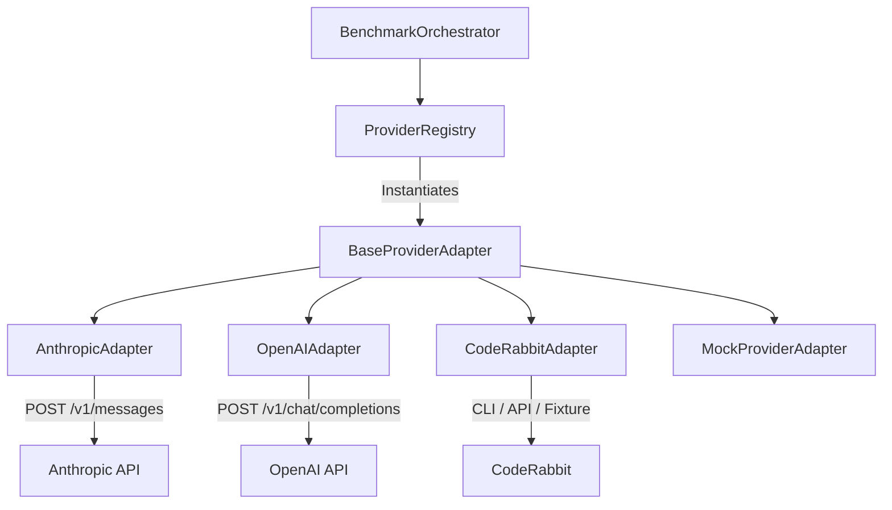

# AI Reviewer Provider Integration Architecture

Phase 3 establishes the provider integration layer, unifying multiple AI code reviewers under a common execution, configuration, and response normalization contract.

---

## 1. Selected Providers & Technical Justification

The benchmark system implements three AI code reviewer integrations:

| Provider | Adapter Class | Primary Model | Integration Protocol | Auth Mechanism |
|---|---|---|---|---|
| **Anthropic Claude** | `AnthropicAdapter` | `claude-3-5-sonnet-20241022` | Direct HTTPS `/v1/messages` | `ANTHROPIC_API_KEY` header (`x-api-key`) |
| **OpenAI GPT-4o** | `OpenAIAdapter` | `gpt-4o` | Direct HTTPS `/v1/chat/completions` | `OPENAI_API_KEY` header (`Bearer`) |
| **CodeRabbit AI** | `CodeRabbitAdapter` | `coderabbit-review` | Multi-mode (REST API, CLI, Fixture) | `CODERABBIT_API_KEY` |

### Technical Justification
1. **Anthropic Claude (Messages API)**:
   - **Industry benchmark for coding intelligence**: State-of-the-art reasoning on architectural and subtle boundary-condition bugs.
   - **Deterministic API**: Official `/v1/messages` endpoint provides direct control over temperature, system prompt, max tokens, and stop reasons.
   - **Detailed Telemetry**: Returns exact token counts (`input_tokens`, `output_tokens`) and HTTP headers for provenance tracking.
   - **Zero External Dependencies**: Implemented using standard library `urllib.request` without requiring proprietary SDK packages.
2. **OpenAI GPT-4o (Chat Completions API)**:
   - **Global standard for automated code analysis**: Fast, consistent, and widely accessible.
   - **Deterministic API**: Standard `/v1/chat/completions` supports system/user role separation, structured reasoning, and strict schema validation.
   - **Token & Latency Tracking**: Delivers precise prompt and completion token counts and duration metrics.
3. **CodeRabbit AI**:
   - **Dedicated PR Review Engine**: Purpose-built automated PR reviewer with file-by-file commenting capabilities.
   - **Flexible Execution Modes**: Supports official REST API, local CLI execution (`coderabbit review`), and deterministic playback fixtures for testing.

---

## 2. Common Provider Interface & Configuration

All providers derive from `BaseProviderAdapter` (`benchmark/providers/base.py`) and inherit standardized configuration, credential resolution, secret masking, retry logic, and error mapping:



### Configuration Dataclass (`ProviderConfig`)
- `provider_id`: Unique identifier (e.g., `"anthropic"`, `"openai"`).
- `display_name`: Human-readable reviewer label.
- `default_model`: Model identifier (e.g., `"claude-3-5-sonnet-20241022"`, `"gpt-4o"`).
- `api_key_env_var`: Name of environment variable holding the credential.
- `api_url`: Target endpoint URL.
- `timeout_seconds`: HTTP request timeout (default `30.0s`).
- `max_retries`: Number of exponential backoff retry attempts for transport failures (default `2`).
- `backoff_factor`: Initial backoff delay (default `0.2s`).
- `dry_run`: When `True`, generates deterministic review fixtures without billable API calls.

### Secret Masking & Safe Logging
API credentials are never logged in plaintext. `BaseProviderAdapter.mask_secret(key)` produces audit-safe representations:
- `"sk-ant-api03-abcdef1234"` $\rightarrow$ `"sk-...1234"`
- Short secrets $\rightarrow$ `"***"`
- Empty secrets $\rightarrow$ `"<none>"`

---

## 3. Review Request Preparation & Context Conditioning

Review requests are constructed from `ReviewContext` objects containing:
- `case_id`, `case_number`, `pr_title`, `pr_body`.
- `base_commit` (`9b5ac64`), `head_commit`.
- `patch_diff`: The raw patch diff.
- `context_condition`: `CODE_ONLY` or `CODE_AND_SNAPSHOT`.
- `snapshot_content`: Deployment inventory and receiver limits (for cases 04, 05, 06).
- `context_hash`: Immutable SHA-256 hash tracking review context integrity.

### Prompt Standardization
Prompts instruct reviewers to identify:
1. Logic bugs or boundary condition oversights.
2. Data integrity defects or regression risks.
3. Operational, configuration, or deployment conflicts.
4. Performance bottlenecks or scalability hazards.

---

## 4. Response Normalization & Dual Storage

All provider responses are normalized into `ProviderRawResult` containing:
- `raw_content`: Pristine unedited markdown review text.
- `http_status`: HTTP response status code (e.g. 200).
- `external_id`: Provider request/message ID (e.g. `msg_123`, `chatcmpl_456`).
- `prompt_tokens`: Input/prompt token count.
- `completion_tokens`: Output/completion token count.
- `duration_ms`: Execution latency in milliseconds.
- `model_name`: Exact model version reported by provider.
- `finish_reason`: Stop condition (`end_turn`, `stop`, `max_tokens`).

### Dual Storage Architecture
1. **SQLite Database**: Stored in `review_responses` linked to `review_attempts(id)`.
2. **Filesystem Mirror**: Raw text and metadata sidecars preserved at `evidence/raw/<batch_id>/<attempt_id>.md` and `.meta.json`.

---

## 5. Error Hierarchy & Fault Recovery

HTTP status codes and transport errors are systematically mapped to domain exceptions:

| Condition | HTTP Status | Domain Exception | Orchestrator Action |
|---|---|---|---|
| **Invalid Credentials** | 401, 403 | `ProviderAuthenticationError` | Attempt marked `FAILED`, audit logged |
| **Quota / Rate Limit** | 429, Quota Exceeded | `ProviderQuotaError` | Attempt marked `QUOTA_EXHAUSTED`, batch paused |
| **Malformed Request** | 400, 422 | `ProviderFatalError` | Attempt marked `FAILED`, no retries |
| **Gateway / Timeout** | 500, 502, 503, 504, Timeout | `ProviderTransportError` | Exponential backoff retry (up to `max_retries`) |

---

## 6. Testing & Validation

### Automated Offline Tests (No Billable Requests)
By default, all unit and integration tests run offline using mocks or deterministic dry-run modes (`dry_run=True`).
```powershell
py -m unittest discover -s tests -p "test_*.py"
```

### Optional Live Provider Tests
Live integration tests verify end-to-end connectivity with real provider endpoints when credentials are explicitly supplied:
```powershell
# Test live Anthropic API
$env:ANTHROPIC_API_KEY = "your-anthropic-key"
$env:PROOFLINE_LIVE_ANTHROPIC = "1"
py -m unittest tests/test_provider_integration_phase3.py

# Test live OpenAI API
$env:OPENAI_API_KEY = "your-openai-key"
$env:PROOFLINE_LIVE_OPENAI = "1"
py -m unittest tests/test_provider_integration_phase3.py
```

---

## 7. Known Limitations
1. **Live Provider Cost & Quota**: Real API requests incur billable charges and are subject to account tier rate limits. Use `dry_run=True` for routine CI and regression testing.
2. **CodeRabbit CLI Availability**: CodeRabbit CLI mode requires a locally installed `coderabbit` executable. When unavailable, the adapter falls back cleanly to API mode or verified fixtures.
