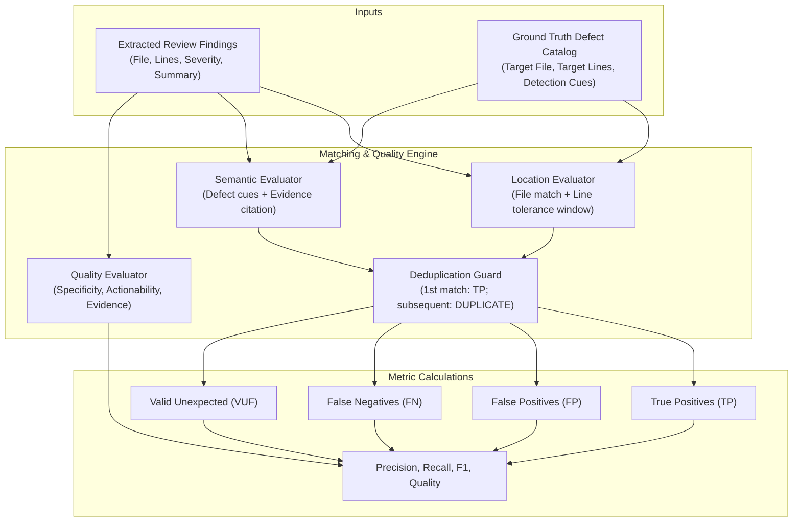

# Scoring, Calibration & Held-Out Evaluation Guide

This guide documents the scoring engine, ground-truth matching algorithm, calibration management, and held-out evaluation methodology implemented in Phase 4 of the Proofline AI Review Benchmark platform.

---

## 1. Evaluation Architecture Overview

The evaluation engine compares extracted review findings (`ReviewFinding`) against authoritative ground truth defects (`GroundTruthDefect`) to measure review precision, recall, and quality without contaminating reviewer inputs.



---

## 2. Ground-Truth Defect Catalog

The benchmark establishes authoritative defect definitions for all 8 cases:

| Case | Category | Expected Action | Target File | Target Lines | Key Defect Description |
|---|---|---|---|---|---|
| **01** | `LOGIC_BUG` | `BLOCK_PR` | `reports.py` | `42-50` | Cursor pagination query `WHERE scheduled_at < ?` without tie-breaker skips duplicate timestamps. |
| **02** | `DATA_INTEGRITY` | `BLOCK_PR` | `reports.py` | `50-57` | Manual CSV concatenation with `join()` without escaping commas/quotes corrupts CSV exports. |
| **03** | `LOGIC_BUG` | `BLOCK_PR` | `reports.py` | `73-90` | Batch loop range drops remaining deliveries when total is not a multiple of `batch_size`. |
| **04** | `DEPLOYMENT_CONFLICT` | `BLOCK_PR` | `migrations/002_retire_format.sql` | `1` | Dropping `legacy_format` column breaks active Elm site workers running older `workers-17` polling SQL. |
| **05** | `CONFIG_LIMIT` | `BLOCK_PR` | `reports.py` | `10` | Increasing `EXPORT_BATCH_SIZE` to 50 exceeds Cedar site receiver `max_rows_per_request` limit of 40. |
| **06** | `DEPLOYMENT_CONFLICT` | `BLOCK_PR` | `reports.py` | `9` | Switching `DELIVERY_QUEUE` to `'report-dispatch'` starves Elm site workers subscribed only to `'reports'`. |
| **07** | `PERFORMANCE` | `APPROVE` | `migrations/002_pending_by_queue.sql` | `1-2` | **Benign Change**: Partial index addition. Expected action is `APPROVE` with zero false alarms. |
| **08** | `CONTRACT_CHANGE` | `APPROVE` | `reports.py` | `86` | **Benign Change**: Added total count to summary. Expected action is `APPROVE` with zero false alarms. |

---

## 3. Finding Matching Rules & Deduplication

Matching is executed by `FindingMatcher` (`benchmark/scoring/matcher.py`):

1. **Location Matching**:
   - Path comparison normalizes slashes across Windows and POSIX (`\` vs `/`).
   - Line tolerance window: Finding line $L$ matches defect range $[S, E]$ if $L \in [S - \text{tolerance}, E + \text{tolerance}]$.
2. **Semantic Matching**:
   - Evaluates keyword presence in `summary` and `raw_comment_slice`.
   - Requires at least `min_keyword_matches` (default: 1).
3. **Evidence Grounding**:
   - Specifically checks whether findings on deployment-sensitive cases (04, 05, 06) cite external inventory facts (e.g., `"Elm"`, `"workers-17"`, `"Cedar"`, `"max_rows"`).
4. **Deduplication Guard**:
   - Only the **first** finding matching a defect is classified as `TRUE_POSITIVE`.
   - All subsequent findings addressing the same defect are classified as `DUPLICATE`.
   - Prevents reviewers from inflating TP counts by posting repetitive comments on the same defect.

---

## 4. Evaluation Metrics & Zero-Denominator Rules

Scoring is handled by `ScoringCalculator` (`benchmark/scoring/metrics.py`):

### Precision, Recall, and F1 Formulae
$$\text{Precision} = \frac{TP}{TP + FP}$$
$$\text{Recall} = \frac{TP}{TP + FN}$$
$$F_1 = \frac{2 \cdot \text{Precision} \cdot \text{Recall}}{\text{Precision} + \text{Recall}}$$

### Zero-Denominator Rules
1. **Benign PRs (Cases 07 & 08)**:
   - Perfect Clean Review ($FP = 0$): Reviewer approved or raised no blocking false alarms $\rightarrow \text{Precision} = 1.0, \text{Recall} = 1.0, F_1 = 1.0$.
   - False Alarm ($FP > 0$): Reviewer raised spurious critical/high bug claims $\rightarrow \text{Precision} = 0.0, \text{Recall} = 1.0, F_1 = 0.0$.
2. **Defect PRs with Zero Detections**:
   - $TP + FP = 0 \implies \text{Precision} = 0.0$.
   - $TP = 0, FN = 1 \implies \text{Recall} = 0.0, F_1 = 0.0$.
3. **Failed / Quota-Exhausted Runs**:
   - Uncompleted attempts receive $TP = 0, FP = 0, FN = 1 \implies F_1 = 0.0$.

---

## 5. Valid Unexpected Findings (VUF)

To avoid penalizing helpful non-defect suggestions:
- **False Positive (`FALSE_POSITIVE`)**: Any finding with severity `critical`, `high`, `error`, or `blocker` that claims non-existent defects.
- **Valid Unexpected Finding (`VALID_UNEXPECTED`)**: Non-blocking observations (severity `info`, `low`, `note`) offering style, documentation, or typing suggestions. These do **not** penalize precision or reduce $F_1$.

---

## 6. Finding Quality Metrics

`FindingQualityEvaluator` (`benchmark/scoring/quality.py`) measures structural quality (0.0 to 1.0):
- **Specificity (0.2 – 1.0)**: Rewards referencing exact file paths and line coordinates.
- **Actionability (0.2 – 1.0)**: Rewards concrete recommendations, keywords (`suggest`, `recommend`, `replace`), and code snippets.
- **Evidence (0.0 or 1.0)**: Flags whether external deployment inventory was grounded in the critique.

---

## 7. Calibration Profiles & Threshold Management

Matching thresholds are managed via `CalibrationProfile` (`benchmark/scoring/calibration.py`):

| Profile | Line Tolerance | Min Keywords | Require File Match | Match Threshold | Description |
|---|---|---|---|---|---|
| **`standard-v1`** | $\pm 5$ lines | 1 | Yes | 0.45 | Balanced standard benchmark configuration. |
| **`strict-v1`** | $\pm 2$ lines | 2 | Yes | 0.60 | High-precision configuration requiring tight line overlap. |
| **`lenient-v1`** | $\pm 12$ lines | 1 | No | 0.35 | High-recall configuration for permissive semantic matching. |

Every profile generates an immutable SHA-256 parameter hash for reproducible auditability.

---

## 8. Held-Out Evaluation & Anti-Contamination

To verify that calibration tuning does not overfit to specific changes, benchmark cases are strictly partitioned:

```text
Benchmark Cases (8 Total)
├── Calibration Partition (4 Cases: 01, 02, 03, 07)
│   └── Used for parameter tuning, prompt calibration, and sensitivity analysis.
│
└── Held-Out Test Partition (4 Cases: 04, 05, 06, 08)
    └── Frozen out-of-sample evaluation. Evaluated blindly with frozen calibration profile.
```

### Anti-Leak Rule Enforcement
`PartitionManager.verify_no_leakage(calibration_cases)` programmatically enforces that held-out cases (04, 05, 06, 08) never appear in calibration sweeps.

### Generalization Measurement
The generalization delta is computed as:
$$\Delta F_1 = F_{1, \text{heldout}} - F_{1, \text{calibration}}$$
If $F_{1, \text{calibration}} - F_{1, \text{heldout}} > 0.25$, an **Overfitting Risk Alert** is surfaced in the report.

---

## 9. Testing & Execution

Run all Phase 4 scoring, calibration, and edge-case tests:
```powershell
py -m unittest tests/test_scoring_calibration_phase4.py
```
Run the full benchmark test suite (Phases 1–4):
```powershell
py -m unittest discover -s tests -p "test_*.py"
```
