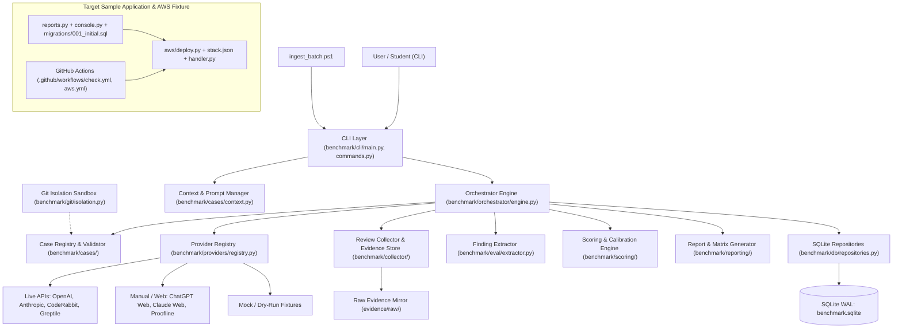

# 02 — Project Architecture

This document explains the complete architecture of the **Proofline AI Pull Request Review Benchmark**, its major subsystems, how data flows through them, and how each component connects to the others.

---

## 1. High-Level System Architecture

---

## 2. Experiment Execution Flow

```mermaid
flowchart LR
    S1["1. Schedule Batch (init-db / run --manual or run)"] --> S2["2. Create PENDING ReviewAttempt rows in SQLite"]
    S2 --> S3{"Execution Mode?"}

    S3 -- "Automated API / Dry-Run" --> S4A["Orchestrator.execute_attempt()"]
    S4A --> S5A["ProviderAdapter.invoke_review()"]
    S5A --> S6["ReviewCollector.collect() -> DB + evidence/raw/"]

    S3 -- "Manual / Web (ChatGPT, Claude, Proofline)" --> S4B["benchmark prompt --case N -> prompts/caseNN.md"]
    S4B --> S5B["Paste to AI Web UI / PR -> save reviews/*.md"]
    S5B --> S5C["benchmark ingest -> Orchestrator.ingest_review()"]
    S5C --> S6

    S6 --> S7["FindingExtractor.extract_findings() -> review_findings"]
    S7 --> S8["ScoringService.evaluate_attempt() -> FindingMatcher + ScoringCalculator"]
    S8 --> S9["Persist finding_evaluations & attempt_scores"]
    S9 --> S10["benchmark report -> Markdown, JSON, CSV"]
```

---

## 3. Component-by-Component Breakdown

### 3.1 Entry Points
- **Purpose:** Parse CLI arguments, route subcommands, and invoke the target sample app or AWS deployment script.
- **Main Files:**
  - `benchmark/__main__.py` — enables `python -m benchmark`.
  - `benchmark/cli/main.py` — `build_parser()` and `main()` supporting 11 subcommands (`init-db`, `list-cases`, `list-providers`, `list-batches`, `run`, `resume`, `report`, `show-attempt`, `calibrate`, `prompt`, `ingest`).
  - `benchmark/cli/commands.py` — implements `cmd_*` handlers.
  - `console.py` — CLI for the *target* report-scheduling app (`reports.py`).
  - `ingest_batch.ps1` — PowerShell helper to batch-ingest `reviews/*.md` files.
- **Inputs:** CLI flags (`--batch-id`, `--providers`, `--cases`, `--context`, `--dry-run`, `--manual`, `--file`, etc.).
- **Outputs:** Exit codes (`0` success, `1` error, `130` interrupt), formatted stdout tables, exported files.
- **Dependencies:** `argparse`, `benchmark.orchestrator`, `benchmark.cases`, `benchmark.db`, `benchmark.providers`, `benchmark.scoring`.

### 3.2 Core Engine (Orchestrator)
- **Purpose:** Coordinates batch scheduling, attempt state machine (`PENDING -> RUNNING -> COMPLETED | FAILED | QUOTA_EXHAUSTED`), retries on `ProviderTransportError`, crash recovery (`recover_and_resume_batch`), intentional repeats, and manual ingestion (`ingest_review`).
- **Main Files:** `benchmark/orchestrator/engine.py` (`BenchmarkOrchestrator`).
- **Inputs:** Experiment ID, batch name, provider IDs, case numbers, context conditions, repeat count, or raw review text (for `ingest_review`).
- **Outputs:** `ExecutionBatch`, `ReviewAttempt` state transitions, `RunEvent` audit logs, summary dicts.
- **Dependencies:** All repositories, `CaseRegistry`, `ProviderRegistry`, `ReviewCollector`, `FindingExtractor`, `ScoringService`, `BenchmarkReportGenerator`.
- **Used by:** `benchmark/cli/commands.py`.

### 3.3 Database Layer
- **Purpose:** Persistent relational storage with WAL journaling, foreign keys, busy timeout, and versioned SQL migrations.
- **Main Files:**
  - `benchmark/db/connection.py` (`get_connection`, `transaction`).
  - `benchmark/db/migrations.py` (`migrate_benchmark_db`, `get_current_version`).
  - `benchmark/db/repositories.py` (11 repository classes for the 11 domain tables).
  - `benchmark/migrations/001_initial_benchmark.sql` (schema definition).
  - `benchmark/domain/enums.py` & `benchmark/domain/models.py` (dataclasses & enums).
- **Inputs:** Domain dataclasses (`Experiment`, `ExecutionBatch`, `ReviewAttempt`, `ReviewResponse`, `ReviewFinding`, `FindingEvaluation`, `AttemptScore`, `RunEvent`, etc.).
- **Outputs:** Persisted rows in `benchmark.sqlite` and hydrated domain objects.
- **Used by:** Orchestrator, Collector, ScoringService, MatrixGenerator, CLI commands.

### 3.4 Benchmark Cases & Git Isolation
- **Purpose:** Discover the 8 benchmark cases on disk, validate patches/snapshots, and build isolated application-only Git repos at baseline `9b5ac64`.
- **Main Files:**
  - `benchmark/cases/registry.py` (`CaseRegistry`).
  - `benchmark/cases/validator.py` (`CaseValidator`).
  - `benchmark/git/repo.py` & `benchmark/git/isolation.py` (`GitIsolationManager`).
- **Inputs:** `cases/01..08/{title.txt, body.md, change.patch, evidence.md}` and Git commit `9b5ac64`.
- **Outputs:** `BenchmarkCase` objects, `ValidationResult`s, ephemeral `IsolatedEnvironment` temp repos with leak checks (`FORBIDDEN_NAMES`).
- **Used by:** `ContextManager`, `BenchmarkOrchestrator`, `cmd_list_cases`.

### 3.5 Prompt Management & Leakage Protection
- **Purpose:** Construct standardized review prompts for `CODE_ONLY` and `CODE_AND_SNAPSHOT` conditions, compute SHA-256 `context_hash`, and block forbidden evaluation tokens.
- **Main Files:** `benchmark/cases/context.py` (`ContextManager`, `ContextSafetyError`).
- **Inputs:** Case number, `ContextCondition`, optional custom instructions.
- **Outputs:** `ReviewContext` with `context_hash` and `provenance` dict; formatted Markdown prompt.
- **Dependencies:** `CaseRegistry`, `ReviewContext`.
- **Used by:** `cmd_prompt`, `OpenAIAdapter`, `AnthropicAdapter`.

### 3.6 Provider Adapter Layer
- **Purpose:** Abstract interface (`BaseProviderAdapter`) and registry (`ProviderRegistry`) for invoking automated or manual AI code reviewers, normalizing HTTP/CLI errors, masking secrets, and supporting dry-run/fixture modes.
- **Main Files:** `benchmark/providers/base.py`, `registry.py`, `openai.py`, `anthropic.py`, `coderabbit.py`, `greptile.py`, `manual.py`, `mock.py`.
- **Inputs:** `ReviewContext` + `ProviderConfig` + environment API keys (`OPENAI_API_KEY`, `ANTHROPIC_API_KEY`, `CODERABBIT_API_KEY`, `GREPTILE_API_KEY`).
- **Outputs:** `ProviderRawResult` (raw Markdown/text, HTTP status, token counts, duration, model name).
- **Used by:** `BenchmarkOrchestrator`, `cmd_list_providers`.

### 3.7 Raw Evidence Collection
- **Purpose:** Dual-write every review response to SQLite (`review_responses`) and disk (`evidence/raw/<batch_id>/<attempt_id>.md` + `.meta.json`).
- **Main Files:** `benchmark/collector/collector.py` (`ReviewCollector`), `benchmark/collector/storage.py` (`RawEvidenceStore`).
- **Inputs:** `ReviewAttempt` + `ProviderRawResult`.
- **Outputs:** `ReviewResponse` row + `.md` and `.meta.json` files on disk.
- **Used by:** `BenchmarkOrchestrator`.

### 3.8 Finding Extraction
- **Purpose:** Deterministically parse unstructured Markdown or structured JSON review responses into atomic `ReviewFinding` records (file path, line range, severity, summary, raw slice).
- **Main Files:** `benchmark/eval/extractor.py` (`FindingExtractor`).
- **Inputs:** `ReviewResponse`.
- **Outputs:** `list[ReviewFinding]`.
- **Used by:** `BenchmarkOrchestrator`.

### 3.9 Finding Matching, Scoring, Calibration & Held-Out Evaluation
- **Purpose:** Compare extracted findings against `STANDARD_GROUND_TRUTHS`, suppress duplicates, evaluate finding quality, compute Precision/Recall/F1/VUF, manage calibration profiles, and measure calibration-vs-heldout generalization.
- **Main Files:**
  - `benchmark/scoring/matcher.py` (`FindingMatcher`, `MatchingConfig`).
  - `benchmark/scoring/metrics.py` (`ScoringCalculator`, `MetricSummary`).
  - `benchmark/scoring/calibration.py` (`CalibrationProfile`, `CalibrationRegistry`).
  - `benchmark/scoring/heldout.py` (`PartitionManager`, `GeneralizationReport`).
  - `benchmark/scoring/quality.py` (`FindingQualityEvaluator`).
  - `benchmark/scoring/service.py` (`ScoringService`, `STANDARD_GROUND_TRUTHS`).
- **Inputs:** `ReviewAttempt`, `list[ReviewFinding]`, `GroundTruthDefect`, `CalibrationProfile`.
- **Outputs:** `list[FindingEvaluation]`, `AttemptScore`, `GeneralizationReport`.
- **Used by:** `BenchmarkOrchestrator`, `cmd_calibrate`.

### 3.10 Report Generation
- **Purpose:** Aggregate attempt scores into provider-by-case matrices, context ablation tables, denominator breakdowns, and partition comparisons; export as Markdown, CSV, and JSON.
- **Main Files:** `benchmark/reporting/matrix.py` (`BenchmarkMatrixGenerator`), `benchmark/reporting/formatters.py` (`MarkdownFormatter`, `CSVFormatter`, `JSONFormatter`, `BenchmarkReportGenerator`).
- **Inputs:** `batch_id` + SQLite repositories.
- **Outputs:** Markdown string, JSON dict/file, and 4 CSV files (`_matrix.csv`, `_ablation.csv`, `_denominators.csv`, `_partition.csv`).
- **Used by:** `BenchmarkOrchestrator`, `cmd_report`, `cmd_run`.

### 3.11 External Integrations, AWS & GitHub Actions
- **External Integrations:** OpenAI Chat Completions API, Anthropic Messages API, CodeRabbit REST API / CLI, Greptile REST API, Proofline GitHub App (manual PR comment ingestion).
- **AWS Components:** `aws/stack.json` (CloudFormation creating `AWS::Logs::LogGroup` + `AWS::Lambda::Function` `ai-review-bench`), `aws/handler.py` (in-memory SQLite Lambda handler for `reports.py`), `aws/deploy.py` (package/smoke/deploy/verify/delete CLI), `aws/github-roles.yaml` (GitHub OIDC `DeploymentRole` + Lambda `RuntimeRole`).
- **GitHub Actions:** `.github/workflows/check.yml` (runs `aws/deploy.py package` + `smoke` and `unittest discover tests` on PR/push to `main`); `.github/workflows/aws.yml` (manual `workflow_dispatch` on `main` to deploy/verify or delete AWS stack via OIDC).
