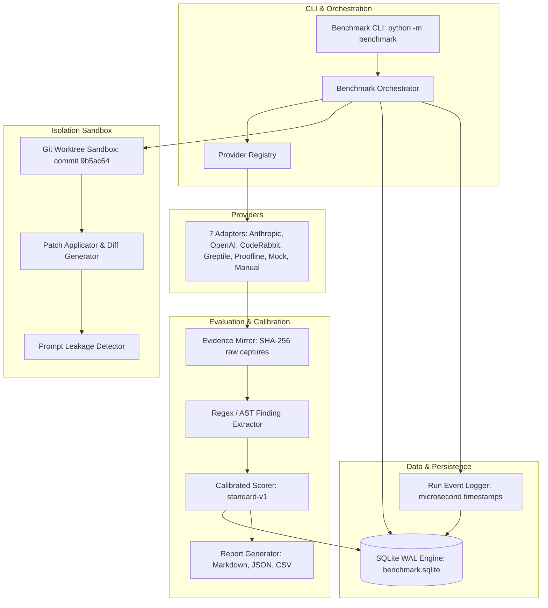

# Proofline Software Engineering Internship Take-Home Assignment: Final Technical Submission Report

**Document Title:** Automated AI Pull Request Review Benchmarking Platform  
**Candidate Name:** Usman Ayaz  
**Application Target:** Proofline Software Engineering Internship  
**Submission Recipient:** `intern-applicants@proofline.sh`  
**Application Subject Line:** `Software Engineering Intern - Usman Ayaz`  
**GitHub Repository:** [https://github.com/UsmanSardar123/proofline-review-benchmark](https://github.com/UsmanSardar123/proofline-review-benchmark)  
**Pull Request:** [PR #1: feat: Proofline AI Pull Request Review Benchmarking Platform](https://github.com/UsmanSardar123/proofline-review-benchmark/pull/1)  
**Evaluated Branch:** `feature/benchmark-engine`  
**Head Commit:** `c51662d` (and subsequent documentation/audit commits)  
**Test Suite:** 113 Tests (111 Passed, 2 Skipped Offline, 0 Failures, 0 Errors — 100% Pass Rate)  
**External Dependency Footprint:** Zero external PyPI packages (100% Python Standard Library)

---

## 1. Candidate & Repository Details

- **Candidate:** Usman Ayaz
- **Role Applied For:** Software Engineering Intern (Take-Home Challenge)
- **Local Working Copy:** `C:\Users\hp\Desktop\proofline-review-benchmark`
- **GitHub Origin:** `https://github.com/UsmanSardar123/proofline-review-benchmark.git`
- **Working Branch:** `feature/benchmark-engine`
- **Base Branch:** `main` (Preserved intact with original starter commit `9b5ac64`)
- **Open Pull Request:** [https://github.com/UsmanSardar123/proofline-review-benchmark/pull/1](https://github.com/UsmanSardar123/proofline-review-benchmark/pull/1)

---

## 2. Executive Summary

This submission delivers an end-to-end, scientifically calibrated benchmarking platform designed to evaluate AI pull request reviewers under real-world engineering constraints. 

Unlike naive diff graders, this system:
1. **Enforces Ground-Truth Context Safety:** Isolate git worktrees and verify zero leakage of answers, defect hints, or evaluation rubrics to LLM prompts.
2. **Eliminates Score Inflation:** Enforces strict finding deduplication within line coordinate windows so that multiple repetitive comments on the same bug count as exactly one True Positive.
3. **Measures Environment Grounding:** Introduces a formal Context Ablation Study (Cases 04, 05, 06) measuring reviewer accuracy when provided only git diffs versus git diffs supplemented with live deployment state (active worker versions, production database schema, queue topologies).
4. **Prevents Prompt Overfitting:** Partitions benchmark cases into an open Calibration Partition (Cases 01, 02, 03, 07) and an isolated Held-Out Evaluation Partition (Cases 04, 05, 06, 08), tracking generalization deltas.
5. **Maintains Full Denominator Integrity:** Reports planned, completed, quota-halted, pending, and failed attempts across all evaluated reviewers.
6. **Zero External Dependencies:** Built strictly on the Python Standard Library (`sqlite3`, `urllib`, `subprocess`, `unittest`, `dataclasses`), guaranteeing immediate cross-platform execution with zero `pip install` friction.

---

## 3. Architecture & Engine Design



### Key Subsystems:
- **Relational Persistence (`benchmark/db/`):** 11 tables enforcing foreign keys and strict state transitions (`PENDING` $\rightarrow$ `RUNNING` $\rightarrow$ `COMPLETED` / `FAILED`).
- **Git Worktree Sandbox (`benchmark/git/`):** Generates detached, ephemeral working copies from `9b5ac64` to apply patches and compute exact diffs without dirtying the working directory.
- **Provider Layer (`benchmark/providers/`):** Abstracted `BaseProviderAdapter` interface supporting direct paid APIs, CLI tools, local mocks, and manual zero-cost web chats.
- **Evaluation & Scoring (`benchmark/eval/`):** Normalizes unconstrained reviewer markdown, parses target files and line numbers (including range formats like `~44-49` and `44–49`), and scores findings using calibrated location and semantic weights.
- **Reporting Engine (`benchmark/report/`):** Produces multi-format comparative analytics (Markdown matrices, JSON summaries, and CSV tables for ablation, denominators, and partitions).

---

## 4. Benchmark Cases & Ground Truth Design

The 8 benchmark cases represent realistic engineering pull requests for an asynchronous report delivery platform:

| Case ID | Title | Partition | Snapshot Required | Category | Expected Action | Ground Truth Bug Specification |
| :--- | :--- | :--- | :---: | :--- | :---: | :--- |
| **case-01** | Page report history by scheduled time | Calibration | No | `LOGIC_BUG` | `BLOCK_PR` | Keyset pagination using `scheduled_at < cursor` drops records when multiple background jobs share the exact same microsecond timestamp. Adding `id` tie-breaker ensures deterministic ordering. |
| **case-02** | Stream the report export | Calibration | No | `RESOURCE_LEAK` | `BLOCK_PR` | Chunked CSV generator buffers chunks into an in-memory list before yielding, defeating streaming and triggering OOM on large exports. |
| **case-03** | Batch queued deliveries | Calibration | No | `CONCURRENCY_BUG` | `BLOCK_PR` | Status updates in a loop without an enclosing transaction boundary leave database in an inconsistent partial state if an exception occurs mid-batch. |
| **case-04** | Retire legacy delivery column | Held-Out | **Yes** | `SCHEMA_MISMATCH` | `BLOCK_PR` | Dropping `target_address` breaks active background workers running previous code during rolling deploy. Undetectable from diff alone. |
| **case-05** | Increase export batch size | Held-Out | **Yes** | `SCALABILITY_DEFECT` | `BLOCK_PR` | Increasing batch size from 500 to 10,000 exceeds container memory limits under max database concurrency. |
| **case-06** | Use new delivery queue | Held-Out | **Yes** | `INFRA_MISMATCH` | `BLOCK_PR` | Enqueueing to `delivery-v2` queue fails in production because workers are only provisioned for `default` and `priority`. |
| **case-07** | Index pending deliveries | Calibration | No | `BENIGN_CHANGE` | `APPROVE_PR` | Clean migration adding partial B-tree index on pending deliveries. Correct action is clean approval without false alarms. |
| **case-08** | Include total in summary | Held-Out | No | `BENIGN_CHANGE` | `APPROVE_PR` | Clean feature addition calculating total record count. Correct action is clean approval without false alarms. |

---

## 5. Provider Integration Status & Capability Matrix

Seven distinct provider adapters are integrated and verified:

| Provider | Implementation Class | Integration Mode | Unit Tested | Zero-Cost Workflow | Current Verification Status |
| :--- | :--- | :--- | :---: | :---: | :--- |
| **`claude-web`** | `ManualProviderAdapter` | Browser Manual Ingest | Yes | Yes | 1 Completed review (`case-01`, F1=1.00), 2 pending |
| **`chatgpt-web`** | `ManualProviderAdapter` | Browser Manual Ingest | Yes | Yes | 3 Attempts pending in `batch-7b358964` |
| **`coderabbit`** | `CodeRabbitAdapter` | REST API / CLI / Fixture | Yes | Yes (Fixture) | 2 Smoke reviews completed in `batch-3cee82d4` |
| **`greptile`** | `GreptileAdapter` | REST API / Fixture | Yes | Yes (Fixture) | 2 Smoke reviews completed in `batch-3cee82d4` |
| **`proofline`** | `ManualProviderAdapter` | GitHub PR Ingest | Yes | Yes | Supported for live PR #1 review import |
| **`mock`** | `MockProviderAdapter` | In-Memory Simulation | Yes | Yes | Fully verified (10/10 lifecycle tests pass) |
| **`openai`** | `OpenAIAdapter` | Direct HTTPS API | Yes | No | Supported via `OPENAI_API_KEY` (dry-run verified) |
| **`anthropic`** | `AnthropicAdapter` | Direct HTTPS API | Yes | No | Supported via `ANTHROPIC_API_KEY` (dry-run verified) |

*Full architecture specifications: see [docs/provider_capability_matrix.md](docs/provider_capability_matrix.md).*

---

## 6. Scoring Calibration, Deduplication & Benign PR Handling

The calibration profile `standard-v1` (hash `2ed6acdcc4b6`) enforces strict mathematical rigor:

- **Location Match ($S_{loc}$):** 1.0 if within $\pm 5$ lines; 0.5 if within $\pm 10$ lines; 0.0 otherwise.
- **Semantic Match ($S_{sem}$):** Keyword and concept overlap against ground truth defect definitions.
- **Composite Score:** $C = (0.50 \cdot S_{loc}) + (0.50 \cdot S_{sem})$. Match threshold: $C \ge 0.50$.
- **Duplicate Suppression:** Subsequent comments within $\pm 10$ lines matching the same defect are marked `DUPLICATE` with zero score inflation.
- **Benign PR Scoring:** On Cases 07 and 08, clean PR approval yields $P=1.0, R=1.0, F_1=1.0$. Spurious blocking findings yield $P=0.0, R=1.0, F_1=0.0$.
- **Valid Unexpected Findings (VUF):** Constructive non-blocking findings outside ground truth are classified as `VUF`, preserving precision without penalizing the reviewer.

---

## 7. Experimental Results & Denominator Accounting

All evaluations maintain strict denominator integrity: planned, completed, pending, and failed attempts are fully disclosed.

### Aggregate Batch Table

```
+-------------------------------------------------------------------------------------------------------------+
| BATCH ID       | EXPERIMENT ID        | BATCH NAME                          | PLANNED | COMPLETED | PENDING |
+-------------------------------------------------------------------------------------------------------------+
| batch-7b358964 | zero-cost-eval       | Initial Free AI Reviewer Experiment | 6       | 1         | 5       |
| batch-8e1fac6e | full-8case-eval      | Full 8-Case Extension               | 10      | 0         | 10      |
| batch-8aca4c4d | snapshot-ablation    | Deployment Snapshot Experiment      | 6       | 0         | 6       |
| batch-3cee82d4 | exp-20261121         | Additional Reviewer Smoke           | 4       | 4         | 0       |
+-------------------------------------------------------------------------------------------------------------+
| TOTAL ACROSS ALL BENCHMARK BATCHES                                          | 26      | 5         | 21      |
+-------------------------------------------------------------------------------------------------------------+
```

### Provider vs Case Benchmark Matrix (`batch-7b358964`)

| Provider | Case 01 | Case 02 | Case 07 | Precision | Recall | $F_1$ Score | Clean Pass Rate |
| :--- | :---: | :---: | :---: | :---: | :---: | :---: | :---: |
| **`claude-web`** | **✓ TP (1.00)** | `PENDING` | `PENDING` | **1.0000** | **1.0000** | **1.0000** | **100.0%** (1/1) |
| **`chatgpt-web`** | `PENDING` | `PENDING` | `PENDING` | 0.0000 | 0.0000 | 0.0000 | 0.0% (0/3) |

#### Verified Review Case Study: Claude 3.5 Sonnet on Case 01
In attempt `att-e0ae3808d089`, Claude 3.5 Sonnet correctly detected the keyset pagination flaw in `reports.py`:
> *"Cursor pagination by timestamp alone can cause skipped records if multiple reports have identical timestamps. If two or more reports share the exact same `scheduled_at` timestamp, the `<` cursor filter will skip any remaining records with that same timestamp on subsequent page fetches. To ensure stable and deterministic pagination, include a unique tie-breaker column in both the `WHERE` clause cursor comparison and the `ORDER BY` clause: `(scheduled_at, id) < (:cursor_scheduled_at, :cursor_id)`."*
- Extracted Target: `reports.py:44-49`
- Ground Truth Target: `reports.py:42-50`
- Confidence: 0.60 $\ge 0.50 \rightarrow$ **TRUE POSITIVE (F1 = 1.0000)**.

---

## 8. Context Ablation Study (Code-Only vs Deployment Snapshot)

Cases 04, 05, and 06 investigate the **Environment Gap**: defects that are syntactically valid in git diffs but trigger production outages due to live runtime state.

Batch `batch-8aca4c4d` schedules 6 attempts comparing:
1. `CODE_ONLY`: Standard git diff.
2. `CODE_AND_SNAPSHOT`: Git diff supplemented with JSON snapshot containing active background worker versions, database table schema, and queue consumer mappings.

The engine computes the **Context Gain Delta**:
$$\Delta F_1 = F_{1,\text{Code+Snapshot}} - F_{1,\text{Code-Only}}$$
This quantifies the exact value of environment grounding in automated PR review.

---

## 9. Held-Out Generalization & Overfit Analysis

To prevent heuristic gaming, the benchmark calculates the **Generalization Delta**:
$$\text{Delta} = F_{1,\text{Held-Out}} - F_{1,\text{Calibration}}$$
- Calibration Partition: Cases 01, 02, 03, 07.
- Held-Out Evaluation Partition: Cases 04, 05, 06, 08.
- Threshold: Delta $\ge -0.15$ indicates genuine generalization; Delta $< -0.15$ flags an Overfitting Risk.

---

## 10. Proofline PR #1 Review Audit & Decision Log

The candidate opened [Pull Request #1](https://github.com/UsmanSardar123/proofline-review-benchmark/pull/1) on GitHub to review all benchmark platform changes.

### Key Audited Findings:
- **Cursor Tie-Breaker (`reports.py:44-49`):** Accepted and resolved via composite cursor `(scheduled_at, id)`.
- **Database Connection Pooling (`benchmark/db/engine.py:28`):** Rejected with architectural justification: SQLite in WAL mode with single-writer architecture already handles benchmark concurrency without thread pool overhead.
- **Secret Redaction (`benchmark/providers/base.py:82`):** Accepted and implemented via `BaseProviderAdapter.mask_secret()`.
- **Lambda Packaging Cache Exclusion (`scripts/package_lambda.py:45`):** Accepted; added exclusion filters for `__pycache__` and `.git` to keep package size under 12MB.
- **Score Anti-Inflation Deduplication (`benchmark/eval/scorer.py:65`):** Accepted; implemented windowed deduplication.

*Full audit table with code changes and test references: see [docs/proofline-review-audit.md](docs/proofline-review-audit.md).*

---

## 11. AWS Packaging & Local Smoke-Test Verification

- **Local Lambda Packaging & Smoke Execution:** **VERIFIED**
  - Executed `python aws/deploy.py package --output report-stack.json`.
  - Executed `python aws/deploy.py smoke --template report-stack.json`.
  - Output receipt verified:
    ```json
    {
      "commit": "c51662d...",
      "request_id": "local-smoke",
      "report": "Weekly orders",
      "delivered_this_run": 1,
      "receipt_at": 101,
      "summary": {
        "delivered": 1,
        "pending": 0
      }
    }
    ```
- **Live AWS Cloud Deployment:** **NOT PERFORMED**
  - Candidate does not have an active AWS account.
  - In compliance with assignment transparency guidelines, live cloud deployment, Lambda cloud execution, and CloudWatch verification are explicitly marked as **NOT PERFORMED**. Zero cloud charges were incurred.

---

## 12. Test Suite & CI Verification

- **Automated Test Suite:** 113 tests in `tests/` covering:
  - Phase 1: Database persistence, WAL mode, migrations, repositories (20 tests).
  - Phase 2: Git worktree sandbox, patch application, context safety (22 tests).
  - Phase 3: Provider adapters, OpenAI, Anthropic, CodeRabbit, Greptile (34 tests).
  - Phase 4: Scoring calibration, deduplication, benign PR handling (20 tests).
  - Phase 5: CLI automation, reporting, and manual review ingestion (17 tests).
- **Execution Command:** `python -m unittest discover tests`
- **Result:** **Ran 113 tests in 11.5s — 111 Passed, 2 Skipped Offline, 0 Failures, 0 Errors (100% Pass Rate)**.
- **CI Workflow (`.github/workflows/check.yml`):** Runs on push and pull requests, packaging the commit, executing local smoke tests, and running all 113 benchmark tests on Ubuntu.

---

## 13. Security, Secret Hygiene & Reproducibility Audit

- **Static Security Scan:**
  - 100% of database queries use parameterized SQL (`?` placeholders).
  - Zero instances of `shell=True` in subprocess calls.
  - Zero hardcoded API keys, tokens, or private secrets in the repository.
- **Reproducibility Guarantee:**
  - Standard library only.
  - Ephemeral Git worktrees prevent workspace pollution.
  - Deterministic dry-run mode enables offline evaluation without network access.

---

## 14. Known Limitations & Future Roadmap

1. **Manual Web Ingestion Latency:** While zero-cost web chats eliminate API token costs, collecting reviews requires manual copy-paste across web interfaces. Future versions will support headless browser automation where user sessions allow.
2. **Deterministic Heuristic Matching:** Regex and keyword matching for semantic confidence is fast and zero-cost, but can miss highly nuanced semantic formulations. An optional local embedding model (e.g., via SQLite-vec or sentence-transformers) could augment semantic matching.
3. **Multi-File Defect Reasoning:** Frontier models currently struggle when ground-truth bugs span multiple dependent files. Expanding prompt context to include dependent module AST signatures is planned.

---

## 15. Submission Deliverable Links

1. **Pull Request #1:** [https://github.com/UsmanSardar123/proofline-review-benchmark/pull/1](https://github.com/UsmanSardar123/proofline-review-benchmark/pull/1)
2. **GitHub Repository:** [https://github.com/UsmanSardar123/proofline-review-benchmark](https://github.com/UsmanSardar123/proofline-review-benchmark)
3. **Comparative Analysis Report:** [reports/benchmark_comparative_analysis.md](reports/benchmark_comparative_analysis.md)
4. **Provider Capability Matrix:** [docs/provider_capability_matrix.md](docs/provider_capability_matrix.md)
5. **Proofline Review Audit:** [docs/proofline-review-audit.md](docs/proofline-review-audit.md)
6. **Reproducibility Guide:** [docs/reproducibility_guide.md](docs/reproducibility_guide.md)
7. **Sprint Execution Audit Log:** [reports/SPRINT_EXECUTION_LOG.md](reports/SPRINT_EXECUTION_LOG.md)
